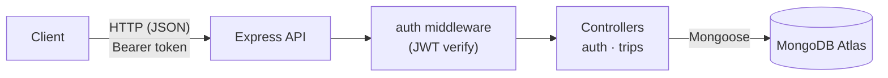

# EzTrip API

A REST API for planning trips and tracking travel expenses. Users sign up, create trips with a total budget and per-category budgets, and log expenses against each trip. Built with **Node.js, Express 5 and MongoDB (Mongoose)**, secured with **JWT authentication**.

### Highlights

- JWT authentication (register, login, protected profile)
- Passwords hashed with bcrypt, never returned in responses
- Full trip CRUD, scoped to the authenticated user
- Expense tracking per trip, with categories and a computed total
- Category budgets: accommodation, food, transportation, activities, shopping, other

## Architecture



## Tech Stack

- Node.js, Express 5
- MongoDB Atlas via Mongoose
- JSON Web Tokens (`jsonwebtoken`) + `bcryptjs`
- `cors`, `dotenv`, `nodemon` for development

## Getting Started

```bash
git clone https://github.com/mrcanarda/eztrip-api.git
cd eztrip-api
npm install
```

Create a `.env` file in the project root:

```env
PORT=5000
MONGODB_URI=mongodb+srv://<user>:<password>@<cluster>/eztrip
JWT_SECRET=your_jwt_secret
JWT_EXPIRE=30d
```

Run the server:

```bash
npm run dev    # with nodemon
npm start      # plain node
```

The API runs at `http://localhost:5000`. `GET /` returns a list of all available endpoints.

## API Endpoints

Protected routes require the header `Authorization: Bearer <token>`.

### Auth

| Method | Path | Description | Access |
|--------|------|-------------|--------|
| POST | `/api/auth/register` | Register `{ name, email, password }`, returns user + JWT | Public |
| POST | `/api/auth/login` | Login `{ email, password }`, returns user + JWT | Public |
| GET | `/api/auth/profile` | Current user's profile | Private |

### Trips

| Method | Path | Description | Access |
|--------|------|-------------|--------|
| GET | `/api/trips` | All trips of the current user (newest first) | Private |
| POST | `/api/trips` | Create a trip | Private |
| GET | `/api/trips/:id` | Get a single trip | Private |
| PUT | `/api/trips/:id` | Update a trip | Private |
| DELETE | `/api/trips/:id` | Delete a trip | Private |
| POST | `/api/trips/:id/expenses` | Add an expense to a trip | Private |
| DELETE | `/api/trips/:id/expenses/:expenseId` | Remove an expense | Private |

### Example: create a trip

```json
POST /api/trips
{
  "destination": "Lisbon",
  "startDate": "2026-05-10",
  "endDate": "2026-05-17",
  "totalBudget": 1500,
  "currency": "EUR",
  "categoryBudgets": {
    "accommodation": 600,
    "food": 350,
    "transportation": 200,
    "activities": 250,
    "shopping": 50,
    "other": 50
  }
}
```

### Example: add an expense

```json
POST /api/trips/:id/expenses
{
  "category": "Food",
  "amount": 42.5,
  "description": "Dinner in Alfama"
}
```

Expense categories: `Accommodation`, `Food`, `Transportation`, `Activities`, `Shopping`, `Other`.

## Data Models

**User:** `name`, `email` (unique), `password` (hashed, min. 6 chars), `createdAt`

**Trip:** `user`, `destination`, `startDate`, `endDate`, `totalBudget`, `categoryBudgets`, `currency` (default `USD`), `expenses[]`, `createdAt`, plus a virtual `totalExpenses`

## Project Structure

```
config/        # MongoDB connection
controllers/   # auth and trip logic
middleware/    # JWT protect middleware
models/        # User and Trip schemas
routes/        # /api/auth and /api/trips routers
server.js      # app entry point
```

## License

MIT
